<p align="center">
  
</p>

<h1 align="center">
  
</h1>

<p align="center">
  <strong>A local molecular workspace for exploring chemical ideas and deciding what to test next.</strong>
</p>

<p align="center">
  <a href="docs/media/molio-complete-tour.mp4">
    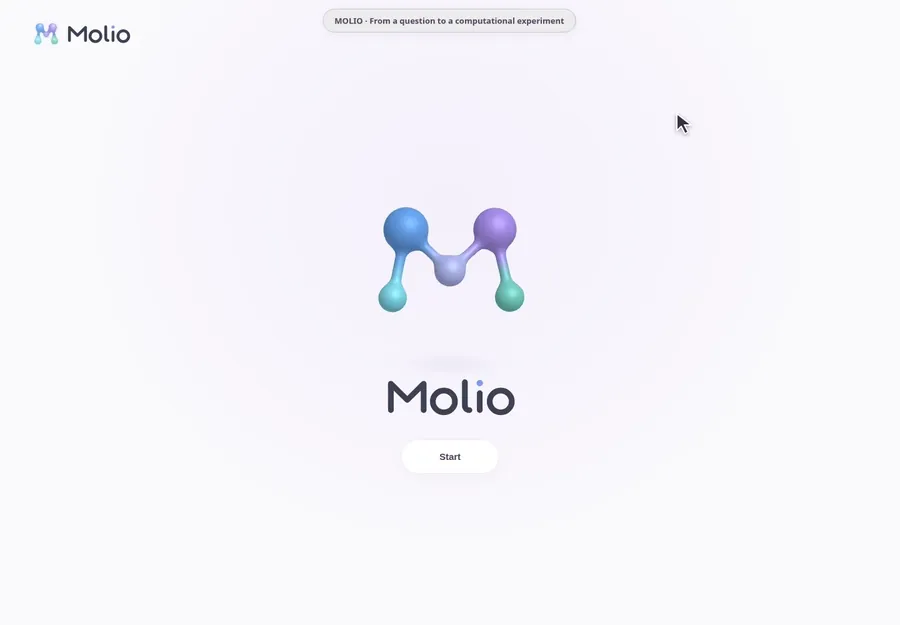
  </a>
</p>

<p align="center">
  <strong><a href="docs/media/molio-complete-tour.mp4">Watch the complete 3-minute 44-second tour</a></strong>
  · <a href="#the-pipeline-in-pictures">Static screenshots</a>
  · <a href="docs/media/README.md">Chapters &amp; recording details</a>
</p>

Molio brings a protein target, small molecules, chemical edits, 3D structures, and optional binding predictions into one project. Start with an existing measured series or an empty protein workspace, propose a change to a molecule, and compare it with its parent while keeping the evidence and prediction inputs traceable.

The question it helps you investigate is: **“If I change this part of my molecule, is the new design worth testing against this protein?”**

Molio is an exploratory research prototype. It can organize evidence and generate computational hypotheses; it does not establish experimental binding or automatically discover a validated drug.

## Contents

- [What you can do](#what-you-can-do)
- [The pipeline in pictures](#the-pipeline-in-pictures)
- [Run Molio locally](#run-molio-locally)
- [Your first project](#your-first-project)
- [Design and compare molecules](#design-and-compare-molecules)
- [Understand the results](#understand-the-results)
- [Enable local Boltz predictions](#enable-local-boltz-predictions)
- [Your data and saved work](#your-data-and-saved-work)
- [Troubleshooting](#troubleshooting)
- [Development and further reading](#development-and-further-reading)

## What you can do

Follow the arrows through the six stages. **Click a card to open its guide.**

<p align="center">
  <a href="#2-choose-your-protein-and-setup-path">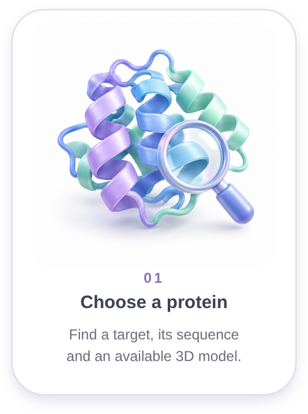</a>
  
  <a href="#3-add-a-starting-molecule">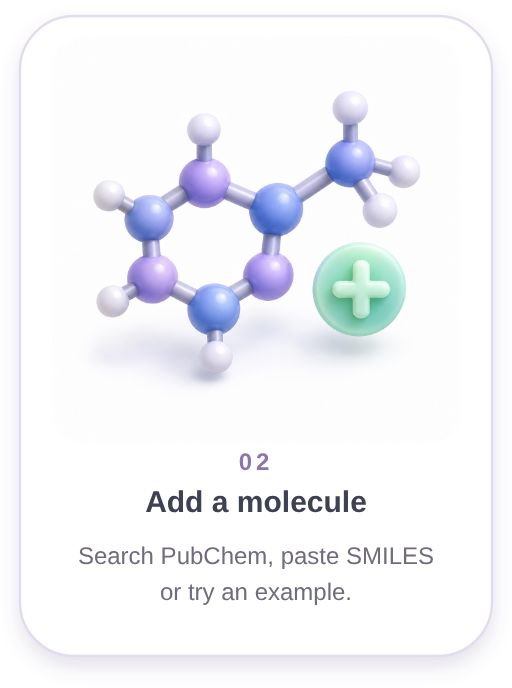</a>
  
  <a href="#explore-a-chemical-change">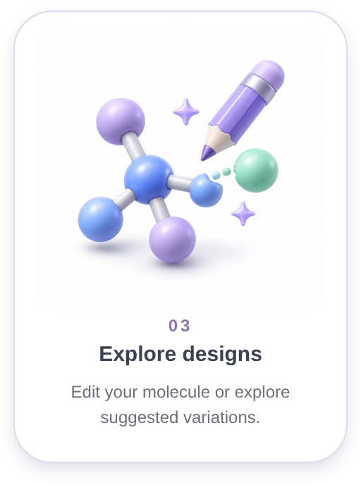</a>
</p>

<p align="center">
  
</p>

<p align="center">
  <a href="#run-a-comparison">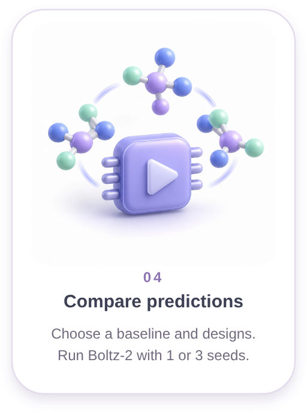</a>
  
  <a href="#understand-the-results">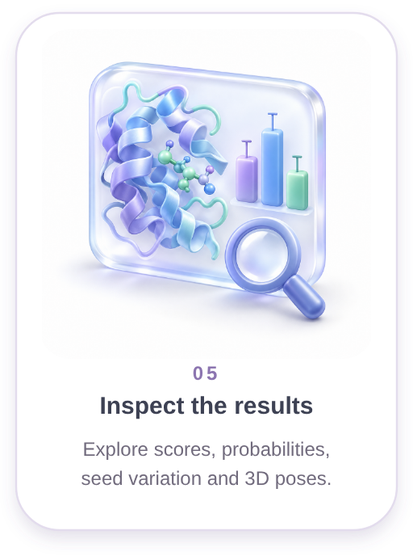</a>
  
  <a href="#your-data-and-saved-work"></a>
</p>

[View the complete pipeline as one image](docs/media/pipeline/molio-pipeline-overview.png).

<details>
<summary>All capabilities in detail</summary>

| Capability | What happens in Molio |
| --- | --- |
| Choose a protein | Search UniProt by name, gene symbol, or accession; check the species before creating a project. |
| Start without measured activity | Download the sequence and an available AlphaFold Database model. Missing measurements or coordinates do not prevent a sequence-first project. |
| Bring in small molecules | Search PubChem, use bundled examples, or paste a name and SMILES. Inspect chemical identity and source records before adding a molecule. |
| Explore existing evidence | Browse the bundled BRD4 series or optionally import a supported ChEMBL assay and an experimental PDB reference. |
| Inspect structures | Rotate and zoom proteins, molecular conformers, and completed predicted complexes; inspect atoms and residues in the relevant viewers. |
| Propose designs | Edit SMILES or generate a small set of scaffold-preserving variations, then inspect their chemistry and calculated properties. |
| Compare predictions | With a configured CUDA runtime, run Boltz-2 on a parent and selected designs, using one or three matched random seeds. |
| Keep a research record | Save proposals and hypotheses, inspect run settings and artifacts, and export evidence or prediction records. |

</details>

This is a guided design-and-comparison loop. It is **not an automatic hyperparameter search or an open-ended chemical optimizer**. You choose the target, starting chemistry, candidate edits, and comparisons. The app does not automatically declare a winning molecule.

## The pipeline in pictures

Follow the extended tour from a new protein workspace to completed predictions. Click any screenshot to open it at full resolution.

<table>
  <tr>
    <td width="50%" valign="top">
      <p><strong>1 · Start a protein project</strong></p>
      <a href="docs/media/molio-tour-protein.png">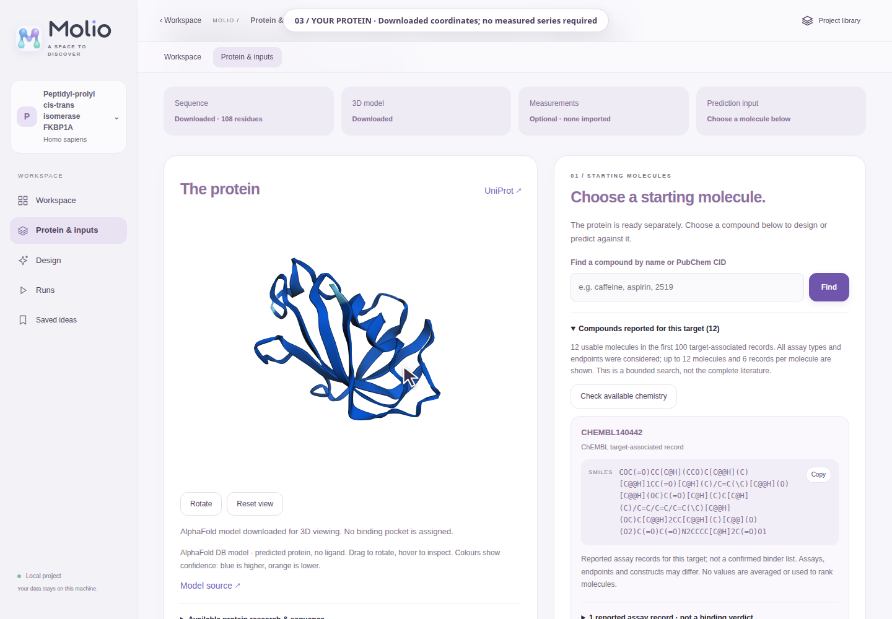</a>
      <p>Search UniProt and start without measured activity. Inspect the downloaded protein and sequence.</p>
    </td>
    <td width="50%" valign="top">
      <p><strong>2 · Bring your own molecule</strong></p>
      <a href="docs/media/molio-tour-input.png">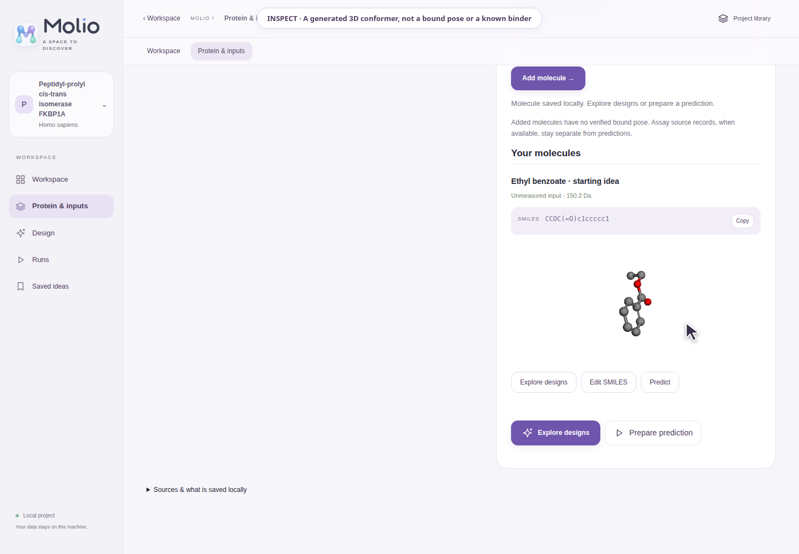</a>
      <p>Paste SMILES, <a href="docs/media/molio-tour-search.png">search PubChem by name</a>, or use an offline example.</p>
    </td>
  </tr>
  <tr>
    <td width="50%" valign="top">
      <p><strong>3 · Create your own design</strong></p>
      <a href="docs/media/molio-tour-editor.png">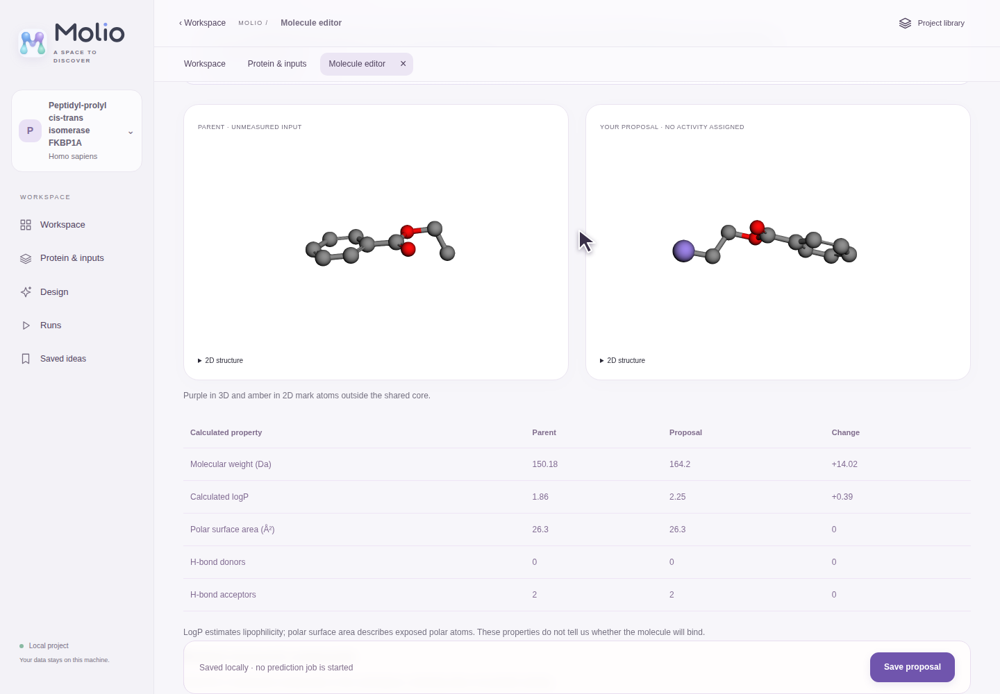</a>
      <p>Edit SMILES, compare the chemistry, and save a proposal with your hypothesis.</p>
    </td>
    <td width="50%" valign="top">
      <p><strong>4 · Explore generated ideas</strong></p>
      <a href="docs/media/molio-tour-designs.png">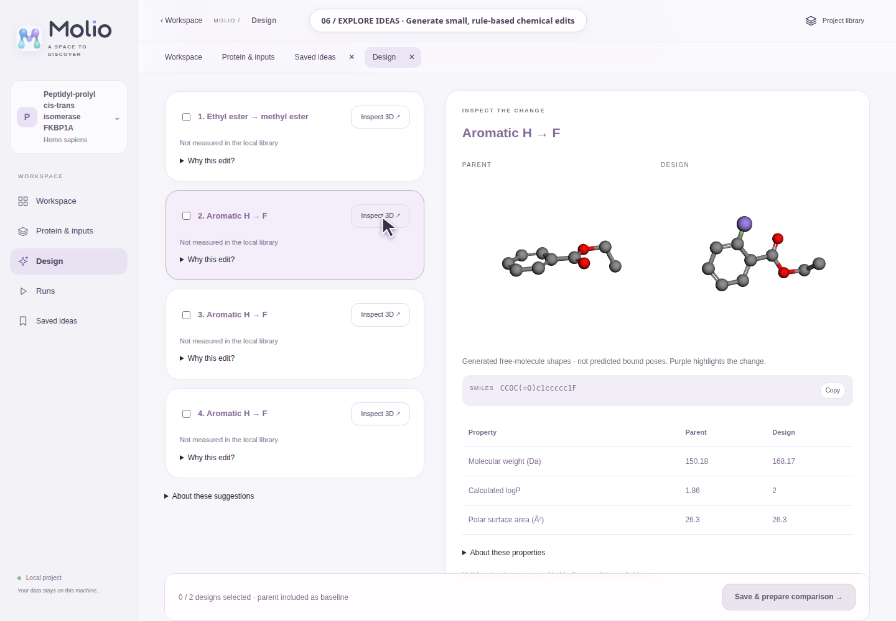</a>
      <p>Inspect small chemical edits in 3D and choose designs to compare.</p>
    </td>
  </tr>
  <tr>
    <td width="50%" valign="top">
      <p><strong>5 · Run matched seeds</strong></p>
      <a href="docs/media/molio-tour-setup.png">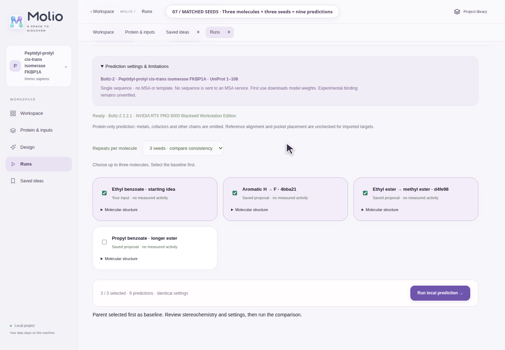</a>
      <p>Select the baseline and two designs. Three seeds per molecule produce nine predictions.</p>
    </td>
    <td width="50%" valign="top">
      <p><strong>6 · Compare consistency</strong></p>
      <a href="docs/media/molio-tour-results.png">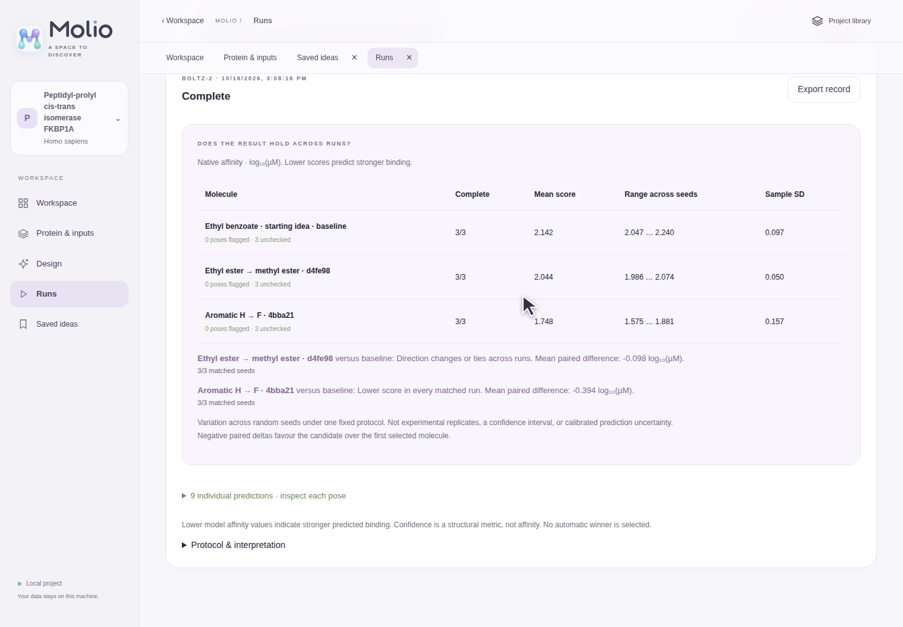</a>
      <p>Inspect native affinity scores, their spread, and matched-seed differences. Repeats are not experimental validation.</p>
    </td>
  </tr>
  <tr>
    <td width="50%" valign="top">
      <p><strong>7 · Understand the outputs</strong></p>
      <a href="docs/media/molio-tour-probability.png">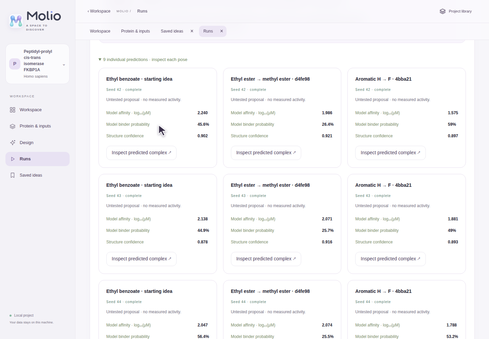</a>
      <p>Model binder probability, affinity, and structural confidence answer different questions; none establishes experimental binding.</p>
    </td>
    <td width="50%" valign="top">
      <p><strong>8 · Inspect the predicted complex</strong></p>
      <a href="docs/media/molio-tour-pose.png">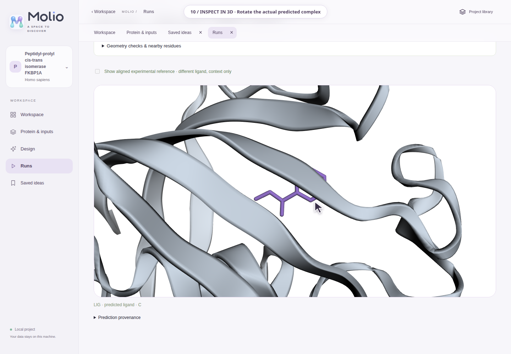</a>
      <p>Rotate the pose, review geometry checks and nearby residues, then export the record.</p>
    </td>
  </tr>
</table>

The final chapter also explores the BRD4 [measured activity map](docs/media/molio-tour-measured.png) and [experimental reference pocket](docs/media/molio-tour-reference.png). Experimental observations remain separate from model predictions.

## Run Molio locally

The commands below assume you are in the repository root. **Linux is the current reference environment; use WSL on Windows.** Python 3.10+ is declared for the application, and the configured chemistry environment uses Python 3.13. The server currently imports Unix `fcntl` for its worker lock, so native Windows serving is not supported by this implementation.

A modern browser with WebGL is needed for interactive 3D. There is no Node build step, frontend CDN, or account requirement.

### Already have the configured environments?

```bash
cd ~/IsoForm
.venv-whatif/bin/python -m molecular_lab --port 8001 \
  --boltz-executable .venv-boltz/bin/boltz
```

Open **[http://localhost:8001](http://localhost:8001)**, then press **Start**.

If you only want to browse, add molecules, and explore designs, omit the Boltz argument:

```bash
.venv-whatif/bin/python -m molecular_lab --port 8001
```

Keep the terminal open while using the app. Press **Ctrl+C** to stop the server. Closing a browser page does not stop the server or cancel a prediction.

### Fresh setup: chemistry and design

From a checkout containing this application:

```bash
python3 -m venv .venv-whatif
.venv-whatif/bin/python -m pip install --upgrade pip
.venv-whatif/bin/python -m pip install -e '.[chemistry]'
.venv-whatif/bin/python -m molecular_lab --port 8001
```

The chemistry extra installs the repository’s pinned RDKit version. RDKit must be installed in the Python environment **running the server**; installing it elsewhere will not enable editing.

### Just explore the bundled example

Without installing chemistry or prediction packages:

```bash
python3 -m molecular_lab --port 8001
```

Choose the BRD4 project from the library. Its nine compounds, seven curated comparisons, source records, molecular drawings, conformers, and experimental protein reference are bundled. Browsing this example needs no GPU or internet after obtaining the repository. Adding molecules, editing structures, and generating designs require RDKit.

| Setup | Browse saved data | Add molecules / design | Run new predictions |
| --- | --- | --- | --- |
| Python + browser | Yes | No | No |
| App with RDKit | Yes | Yes | No |
| App with RDKit + configured Boltz/CUDA environment | Yes | Yes | Yes |

New online searches, source downloads, and initial model-weight downloads require internet. Previously downloaded project data remain local.

### Running on a remote workstation

The server listens on `127.0.0.1`, not on a public network address. Forward port **8001** through your IDE, or run this on your laptop, replacing the SSH destination:

```bash
ssh -L 8001:127.0.0.1:8001 your-user@your-workstation
```

Run Molio on the workstation and visit `http://localhost:8001` on your laptop. This is a local research server without a public multi-user authentication layer.

## Your first project

### 1. Open the project library

**Molio → Start** opens a library of saved projects. Cards show the protein name, species, molecule count, and a preview when coordinates are available. Hover over or keyboard-focus a card to rotate its protein; click the card to open the project.

The library uses three columns on wide screens and fewer on smaller screens. **Pause motion** stops the decorative molecular background and hover rotation. Reduced-motion preferences are respected. The background molecules are decorative artwork, separate from your scientific data.

Choose **New project** to open protein search. BRD4 is an optional bundled example, not a mandatory target.

### 2. Choose your protein and setup path

Search by protein name, gene symbol, or UniProt accession. Check the **species and accession**, especially when names are ambiguous.

**Start empty — the simplest route**

1. Choose **Start empty** on a protein result.
2. Molio downloads its sequence, available annotations, and an available full-sequence AlphaFold DB model.
3. Open the workspace when setup finishes.
4. If coordinates are unavailable, keep working with the sequence and use **Retry model download** later.

This route does not require ChEMBL activities or a ligand-bound crystal structure. The downloaded AlphaFold model is a precomputed visualization reference; Molio does **not** run local AlphaFold inference during setup, and that display model is not supplied as a template to the current Boltz protocol.

**Check measured data — optional experimental context**

When a ChEMBL target link is available, **Check measured data** looks for a supported same-assay IC₅₀ series and compatible ligand-bound X-ray reference. Select the offered assay and structure, then choose **Create local workspace**.

This importer is deliberately selective: it requires exact, positive, unflagged measurements from a supported binding assay and a compatible 40–600 residue protein construct without annotated mutations. It searches bounded sets of activity records and structures. “No supported series found” means the importer did not find a compatible set within those limits; it does **not** mean no one has studied the protein.

If this path fails, return to **Start empty**. A measured-data import creates a separate project; it does not merge into an existing empty workspace. Detailed selection criteria are in the [target setup guide](docs/WHAT_IF_LAB.md#set-up-another-protein-target).

### 3. Add a starting molecule

In a sequence-first project, open **Protein & inputs** and use one of these routes:

| Input | What it provides |
| --- | --- |
| PubChem name or CID search | Chemical identity and SMILES; review the result before adding it. |
| Bundled example | An offline starting point such as anisole, benzamide, or pyridine. These are not suggested as known binders. |
| Your own SMILES | A structure you specify, with a name you choose. RDKit checks supported chemistry and generates a free-molecule 3D conformer. |
| Compounds reported for this target | Available target-associated records, where supported. Their assays and endpoints remain visible and are not treated as one comparable series. |

**SMILES describes a small molecule’s chemical structure. A protein target does not automatically provide a suitable ligand SMILES.** You still need to choose the molecule to investigate. Finding caffeine in PubChem, for example, establishes its identity, not evidence that it binds your chosen protein.

Starter projects currently accept up to **30 starting molecules**. Added molecules must be single connected structures with 2–80 heavy atoms, at most 100 atoms as parsed, and supported organic elements. Mixtures, salts, metals, and unspecified atoms are not supported by this input path.

### 4. Check the protein region before prediction

The local prediction adapter supports **40–600 standard amino-acid residues**. For longer proteins, explicitly select an available domain or an inclusive sequence range in **Protein & inputs**. The selected positions and exact sequence are saved with the run; the full downloaded model remains available for viewing.

A cropped region may omit interactions or change the question you are asking. A domain annotation alone does not identify a ligand-binding pocket. Proteins outside the supported range can still be useful to inspect even when a prediction cannot be prepared.

## Design and compare molecules

### Navigate the workspace

| Page | Use it to… |
| --- | --- |
| Workspace | See your protein, molecule cards, and experiment entry points. |
| Protein & inputs | Manage a sequence-first target, its prediction region, and starting molecules. |
| Measured series | Explore available same-assay comparisons in a measured project. |
| Design | Generate small edits and inspect parent/design structures and properties. |
| Runs | Prepare a comparison, follow progress, inspect results, and open predicted complexes. |
| Saved ideas | Revisit saved proposals and export their records. |
| Reference pages | Inspect the measured molecule library, activity map, pocket, and evidence where available. |

Open pages appear as tabs. Switching pages keeps in-session selections and editor drafts; reloading or switching to another project does not preserve an unsaved editor draft. Save proposals before leaving. On a phone, **Reference** exposes the additional reference pages.

### Explore a chemical change

1. Open a molecule from the workspace and choose **Explore designs**, or open **Design** and select its parent.
2. Inspect the generated ideas, SMILES, property changes, and parent/design conformers.
3. Select one or two designs and choose **Save & prepare comparison**.
4. Molio saves new ideas and opens the run setup with the parent first as the baseline. It does not start prediction yet.

Generation currently returns up to **eight one-step designs** while retaining the parent’s ring scaffold. The supported rules shorten or extend an aromatic ether, shorten an ethyl ester to a methyl ester, or replace an aromatic hydrogen with fluorine. Some molecules have no applicable edit; use **Edit SMILES** to propose a different supported structure.

The editor checks chemistry and displays calculated properties such as molecular weight, logP, polar surface area, and hydrogen-bond counts. These properties help explain a chemical change; they are not predicted potency. Limited edit-evidence matching can retrieve related observations from the bundled library, without transferring those values to a new proposal.

### Run a comparison

This step requires the [optional prediction runtime](#enable-local-boltz-predictions).

1. Select **one to three molecules**. For a design comparison, keep the parent first.
2. Resolve any unspecified stereochemistry by selecting the offered stereoisomer.
3. Choose **one seed** for an initial run or **three matched seeds** to examine variation across runs.
4. Review the protocol and start the comparison explicitly.
5. Follow progress in **Runs**. Completed predictions become inspectable while remaining cases run.
6. Inspect each pose and its checks, compare the scores, and export the run record.

Three molecules with three seeds produce **nine individual predictions**. Only one batch runs at a time across projects in a server’s project directory. Closing Runs does not cancel it; use **Cancel** explicitly. Failed cases retain their errors, and completed cases in a partially failed batch remain available.

For a first walkthrough, open BRD4, choose a measured molecule, generate a small edit, and inspect the comparison setup. You can complete the evidence and design parts without a GPU; only submitting the prediction needs Boltz.

## Understand the results

Always distinguish the source of the information:

| What you see | Meaning | What it does not establish |
| --- | --- | --- |
| Measured IC₅₀ | A sourced experimental concentration for a particular assay. Lower means more potency in that assay. | Comparable activity across different assays or universal binding affinity. |
| Generated molecular shape | A free-molecule conformer generated from SMILES. | How that molecule binds to the protein. |
| Experimental protein reference | Deposited coordinates, sometimes with a reference ligand. | A bound pose for every molecule in your project. |
| AlphaFold DB protein | A downloaded predicted protein model. | A measured complex or a completed ligand-binding experiment. |
| Boltz complex | A newly predicted protein–ligand pose for the recorded inputs. | Experimental confirmation of the pose. |
| Native affinity score | `affinity_pred_value`, reported as log₁₀(IC₅₀ in µM); lower predicts stronger binding. | A measured IC₅₀ or a validated improvement. |
| Binder probability | `affinity_probability_binary`, a model classification output. | A calibrated percentage chance of binding in your experiment. |
| Structural confidence | A model’s structural confidence metric. | Binding strength. |
| Pose-screen flags | Limited geometry/contact diagnostics, with explicit unchecked cases. | Proof of correct chemistry, pocket placement, or binding when no flags appear. |

For a comparison, a **negative candidate-minus-parent affinity difference** favours the candidate’s model score. As an illustrative example, −0.4 versus a parent score of −0.1 gives a difference of −0.3. That suggests a computational hypothesis to inspect; it does not prove the edit improves experimental activity.

Three-seed summaries show means, ranges, sample standard deviations, and matched differences when enough results are available. Seeds **42, 43, and 44** use the same fixed protocol. Their spread reflects sampling variation, not experimental replicates, a confidence interval, or calibrated prediction uncertainty. Small score changes should be considered alongside pose quality and consistency. Flagged and unchecked poses remain represented in the results.

### What is still outside the current scope?

- Molecular dynamics, physical time-evolution simulations, and free-energy calculations.
- Local AlphaFold inference during target setup.
- Exhaustive or autonomous chemical-space optimization, synthesis planning, or automatic winner selection.
- Validated affinity, selectivity, safety, or clinical predictions.
- A general multi-target selectivity screen within the Molio comparison workflow.

The current Boltz protocol uses a single sequence with an empty MSA, no template or pocket conditioning, and omits other chains, metals, and cofactors. Those omissions can matter for the target’s biology. Imported-target pose checks are limited; the specialized experimental-reference alignment is available for the bundled BRD4 workflow. The rotating structures and animated background are visual interactions, not simulations.

## Enable local Boltz predictions

The current adapter requires **Boltz 2.2.1**, a separate **Python 3.12** environment, a CUDA-capable NVIDIA GPU accessible from that environment, and at least **15 GB of free disk space** in the checked cache filesystem. That disk threshold is a preflight check, not a guarantee that every target fits your GPU or that 15 GB covers every future run.

```bash
python3.12 -m venv .venv-boltz
.venv-boltz/bin/python -m pip install boltz==2.2.1

.venv-whatif/bin/python -m molecular_lab --port 8001 \
  --boltz-executable .venv-boltz/bin/boltz
```

Keep the Boltz environment separate from the app/RDKit environment. The run setup reports missing or incompatible runtime requirements. Restart the app after correcting its runtime configuration.

On first use, Boltz downloads shared model weights and supporting data. There is no separately trained model to download for every target. Later offline predictions require those assets to be cached. The current protocol does not submit sequences to an external MSA service.

The adapter uses 3 recycling steps, 200 structure sampling steps, one structure sample per case, and 200 affinity sampling steps with five affinity samples. These are fixed integration settings, not user-tuned search parameters. Runtime depends on protein length, hardware, cache state, and repeat count; each individual case has a two-hour timeout.

### Server options

| Option | Default / purpose |
| --- | --- |
| `--port` | `8001`; use another port if it is occupied. |
| `--project-dir` | `work/whatif`; stores projects, proposals, and experiments. Relative paths are resolved from your working directory. |
| `--boltz-executable` | Optional path to the dedicated `boltz` executable. |
| `--boltz-cache` | Defaults to `PROJECT_DIR/boltz-cache`; can point to a shared local model cache. |

Run `python -m molecular_lab --help` for the actual CLI. The historical `whatif-lab` entry point and some “What-If” filenames remain for compatibility. Run only one server against a given project directory; changing the port alone does not bypass its worker lock.

## Your data and saved work

With the default settings:

```text
work/whatif/
├── proposals.sqlite3                 # Saved proposals for bundled BRD4
├── workspaces/
│   └── lab-…/
│       ├── data/                     # Target data, molecules, sources and structures
│       └── proposals.sqlite3         # Proposals for this imported project
├── experiments/
│   └── <job-id>/
│       ├── job.json                  # Inputs, settings, status and result metadata
│       └── <candidate-and-seed>/      # Input, process.log, model outputs and checks
└── boltz-cache/                       # Downloaded model assets
```

The bundled example is under `molecular_lab/data/`; it is not recreated in every project. Experimental jobs record their workspace ID, sequence, candidate SMILES, protocol, source information, timestamps, and relevant hashes.

| Information | Where it persists |
| --- | --- |
| Downloaded projects and added molecules | Files in the project directory. |
| Saved proposals and hypotheses | The project’s SQLite database. |
| Predictions and run artifacts | The shared experiments directory, scoped to each project. |
| Measured-comparison notes and shortlist selections | This browser’s local storage; include them in an export for portability. |
| Unsaved editor drafts | The current page session only. |

Use **Export shortlist**, proposal exports, or a run’s **Export record** for the corresponding records. JSON exports do not bundle every coordinate artifact or the full project directory. To back up the working lab, stop the server and copy the project directory; export browser-local notes separately. Model caches can be large and are distinct from your research records.

Restarting the server preserves completed projects and jobs. Unfinished jobs are marked interrupted rather than silently resumed. A project URL includes its workspace ID, so separate browser tabs can address different projects; the GPU worker remains shared.

## Troubleshooting

| Symptom | What to do |
| --- | --- |
| `.venv-whatif/bin/python` does not exist | Follow the fresh setup instructions, then run the app from the repository root. |
| “Address already in use” | Use the existing server, stop it in its terminal, or select another port. A second server also needs a different project directory. |
| “Another prediction worker already owns this project directory” | Stop the other server or choose a separate `--project-dir`. Do not delete the lock to run competing workers. |
| RDKit is unavailable | Install `.[chemistry]` with the server environment’s Python and restart using that interpreter. |
| Protein search fails or a provider returns HTTP 500 | Retry later. Existing projects remain usable; adding molecules by SMILES or offline examples avoids compound lookup. |
| No supported same-assay series or compatible reference | Use **Start empty**. This is a limitation of the bounded importer, not evidence of no known chemistry. |
| No protein 3D model | Open the sequence workspace and retry model download later. Missing coordinates and missing sequence are different problems. |
| No starting molecule / SMILES | Add a compound by PubChem lookup, an offline example, or manual SMILES. Choosing a protein does not automatically select a ligand. |
| No generated designs | The current rules may not apply to that parent. Use the SMILES editor; an empty design list is not a prediction of inactivity. |
| Protein is too long for the runner | Explicitly choose a supported 40–600 residue region and review what the crop leaves out. |
| Run is unavailable | Check the reported Boltz version, executable, CUDA availability, free disk, supported region, and stereochemistry selection. |
| A prediction failed | Inspect that case’s `process.log` and error in Runs. Other completed cases remain inspectable. |
| 3D is blank or slow | Use a WebGL-capable browser with hardware acceleration. Pause motion; project-library previews rotate only on hover/focus. |
| Recent interface changes are missing | Refresh the browser; try a hard refresh if its cached assets are stale. |
| Saved project seems missing | Start from the same working directory and use the same `--project-dir`. Browser-local notes also depend on the browser and origin. |

## Development and further reading

The app uses Python’s standard-library HTTP server, plain JavaScript/CSS, locally bundled 3Dmol.js, optional RDKit, SQLite proposals, and a subprocess-based Boltz worker.

| Location | Purpose |
| --- | --- |
| `molecular_lab/web/` | Interface, navigation, molecule/protein viewers, and Molio artwork. |
| `molecular_lab/server.py` | Local HTTP/API entry point. |
| `molecular_lab/targets.py`, `starter.py` | Measured-data imports and sequence-first setup. |
| `molecular_lab/proposals.py`, `designs.py` | Chemistry analysis, saved ideas, and bounded design generation. |
| `molecular_lab/experiments.py`, `repeats.py`, `pose_checks.py` | Prediction execution, seed summaries, and pose diagnostics. |
| `molecular_lab/data/` | Bundled BRD4 fixture and source records. |
| `tests/`, `scripts/` | Unit checks, browser checks, and data/research utilities. |
| `cyp_pipeline/` | Earlier IsoForm CYP/UMA application, retained separately. |

Focused chemistry and workflow checks, from the configured app environment:

```bash
.venv-whatif/bin/python -m unittest \
  tests.test_whatif_proposals tests.test_whatif_designs \
  tests.test_whatif_starter tests.test_whatif_repeats
```

For browser checks, install the browser extra and Chromium in the same environment:

```bash
.venv-whatif/bin/python -m pip install -e '.[chemistry,browser]'
.venv-whatif/bin/python -m playwright install chromium
.venv-whatif/bin/python scripts/check_whatif_browser.py
```

Consult each check’s options before using live-import or inference modes. Ordinary UI checks and real model pilots are separate forms of verification.

- [Detailed app guide](docs/WHAT_IF_LAB.md)
- [Dataset provenance and structural audit](docs/WHAT_IF_DATA_AUDIT.md)
- [First real Boltz pilot](docs/WHAT_IF_BOLTZ_PILOT.md)
- [Matched-seed repeat pilot](docs/WHAT_IF_REPEAT_PILOT.md)
- [Generated-design trial](docs/WHAT_IF_DESIGN_TRIAL.md)
- [Pose-screen audit](docs/WHAT_IF_POSE_AUDIT.md)
- [Product plan](docs/MOLECULAR_WHAT_IF_PLAN.md)
- [Earlier IsoForm application and UMA setup](docs/ISOFORM_LEGACY_README.md)

Pilot reports describe specific recorded runs, not a general validation of predictive accuracy. Historical documentation may use “Molecular What-If Lab,” the earlier name for Molio.

## License and attribution

Original project code is under the [MIT License](LICENSE). Data, bundled libraries, model packages, and model weights retain their own attribution and licensing terms; see [third-party notices](THIRD_PARTY_NOTICES.md).
