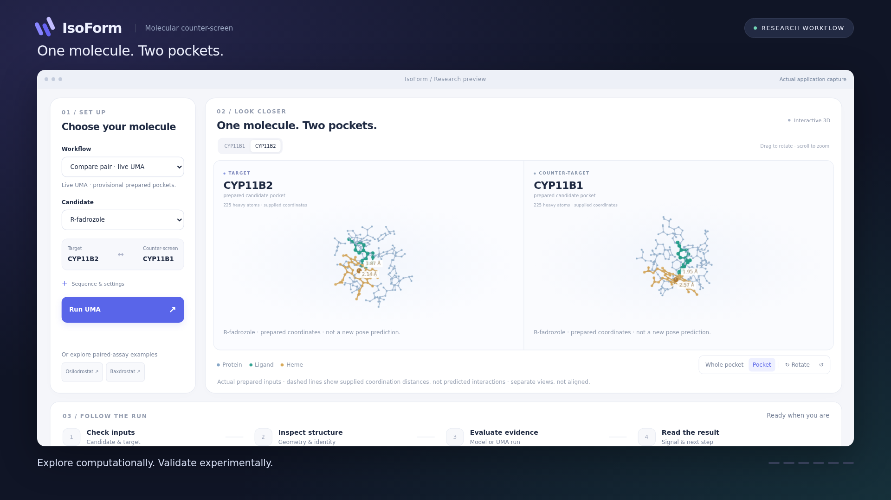

# Earlier IsoForm workspace

This guide documents the earlier CYP/UMA application. For the current Molio app, start with the [main README](../README.md).

**From energy to insight.** An exploratory molecular counter-screening
workspace: trace UMA exchange energies into an empirical fold preference,
inspect protein pockets, compare evidence, and prepare the next experiment.

[53-second energy-to-fold demo](../runs/isoform-video/energy-fold-demo-v2/IsoForm-demo-1080p.mp4)
· [Calibrated workflow](../docs/CALIBRATED_SELECTIVITY.md)
· [App guide](../docs/ISOFORM.md) · [UMA setup](../docs/GETTING_STARTED.md)
· [Scientific scope](../docs/SCIENTIFIC_SCOPE.md)



## Run the demo — no GPU, account, or Python packages needed

Requires Python **3.10+** and a modern browser. From a terminal:

```bash
git clone https://github.com/LeFlochPierre/IsoForm.git
cd IsoForm
python3 -m cyp_pipeline.sentinel_server
```

Open **http://localhost:8000/demo.html**. On Windows, use `python` instead of
`python3`. If using a remote machine, forward port 8000 to your laptop first.

- **Energy → fold preference (default):** recompute supplied osilodrostat
  (3.23× B2) and baxdrostat (103.36× B2) training fits. Compare original minima,
  Boltz seeds and assay endpoints. These are retrospective fits, not independent
  predictions. Metyrapone demonstrates a failed-convergence stop.
- **Explore assay examples:** try osilodrostat and baxdrostat; inspect the assay
  threshold, source labels, and model-disagreement alerts.
- **Prepare more targets:** select a candidate and protein, inspect the real
  reference coordinates, and download a five-protein input bundle.
- **Compare pair · live UMA:** inspect the prepared R/S-fadrozole pockets.
  Starting a new calculation requires the optional UMA setup below.

The source, web app, five reference structures, prepared examples, assay data,
tests, video and selected research reports are included. Existing references
and saved examples work offline. New reference downloads require internet.

Opening the bundled `runs/selectivity-sentinel-demo-v3/demo.html` directly is
also possible, but API features (input building, prepared previews and model
jobs) require the Python server. `report.html` is the older static report.

## Run actual UMA calculations

A GPU is **optional** for the small prepared B1/B2 demo. UMA dependencies and a
separately obtained checkpoint are required; weights and access tokens are
not included. The earlier live-UMA video used UMA-s-1.1 on CPU and completed all eight
energy components in about 163 seconds on the original host. Your runtime may
differ.

Follow [the CPU/GPU setup guide](../docs/GETTING_STARTED.md), then run:

```bash
.venv-mlip/bin/python -m cyp_pipeline.sentinel_server \
  --enable-uma --backend configs/uma-s-1p1-cpu.json
```

Select **R-fadrozole → Compare pair · live UMA → Run UMA**. For a configured
CUDA host, use `configs/uma-s-1p1-cuda.json` instead. The UI displays genuine
component progress and permits result export. No job starts merely by opening
the page. Keep the server local or behind a trusted private tunnel; it is not
an authenticated public compute service.

## What works today?

| Workflow | Available now | What it does not establish |
| --- | --- | --- |
| Paired 3D inspection | Actual R/S-fadrozole prepared B1/B2 pockets | A newly predicted binding pose |
| Live UMA exchange | Eight frozen-coordinate energies per supported pair | Binding affinity or validated selectivity |
| Calibrated fold (default) | Supplied relaxed-energy training fits, original-minima sensitivity and assay comparison | Independent prediction or transferable calibration |
| Live frozen-pocket fold | Explicitly hypothetical Boltzmann energy-weight proxy | Experimental fold selectivity or confidence |
| Saved evidence | Four candidate examples with endpoint and disagreement checks | New inference or a clinical safety claim |
| Input builder | CYP11B1, CYP11B2, CYP11A1, CYP17A1, CYP19A1 references and Boltz inputs | Automatic new-target chemistry or model execution |
| Prepared-pocket upload | Validated batches of up to eight supplied pockets | Ranking unrelated proteins by their total energies |

The intended use is to organize exploratory evidence and decide what needs
testing next. Solvent, entropy, thermal sampling, chemistry review and paired
experimental assays are not replaced by the energy proxy. An enormous proxy
value is **not evidence of enormous biological selectivity**.

## Tests and development

The core has no third-party dependencies:

```bash
python3 -m unittest discover -s tests
```

Optional virtual environment and console entrypoint:

```bash
python3 -m venv .venv
source .venv/bin/activate
python -m pip install -e '.[browser]'
python -m playwright install chromium
python scripts/check_sentinel_browser.py
python scripts/check_calibrated_browser.py
python scripts/check_isoform_preview_races.py
```

The default browser checks do not run UMA. `--live` explicitly opts into one
real CPU job. On minimal Linux hosts Playwright may require OS browser
libraries; see [setup and testing](../docs/GETTING_STARTED.md). Use the Linux/WSL
instructions for the tested scientific runtime. Core demo serving is portable
across Python-supported systems.

After changing web assets, regenerate the bundled page:

```bash
python3 -m cyp_pipeline.sentinel_demo \
  --result runs/selectivity-sentinel-demo-v3/result.json \
  --structure data/raw/4FDH.pdb \
  --out runs/selectivity-sentinel-demo-v3/demo.html
```

## Repository map

- `cyp_pipeline/`: web API, renderer, input builder, UMA and benchmark workflows.
- `prepared/`: complete supplied examples and preparation/audit metadata.
- `data/raw/`, `data/benchmarks/`: reference structures and sourced assay records.
- `configs/`: portable CPU/CUDA configs, panels and protocol definitions.
- `tests/`: numerical checks, validation, API and portability tests.
- `scripts/`: research utilities, browser checks and reproducible video capture.
- `runs/selectivity-sentinel-demo-v3/`: runnable app and saved evidence.
- `runs/isoform-video/powerpoint-demo-v2/`: MP4, poster and actual-run provenance.
- `docs/`: scientific contracts, setup, architecture and historical research.
- `design/`: exploratory CYP11B1 design-campaign records.

Large model caches, environments, transient video frames, unpublished job
directories and credentials are deliberately excluded. No local research
outputs are deleted. See [sharing and provenance](../docs/REPOSITORY.md).

## License and attribution

Original project code is under the [MIT License](../LICENSE). Protein structures,
model packages and weights have their own provenance and upstream terms; see
[third-party notices](../THIRD_PARTY_NOTICES.md). This is a research prototype,
not a validated diagnostic or drug-development decision system.
